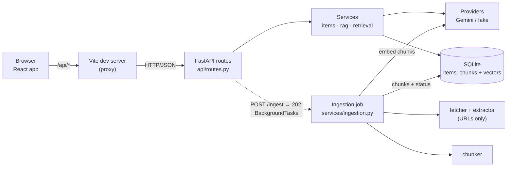

# AI Knowledge Inbox

Save notes or URLs, then ask questions answered from your saved content, with cited sources.

FastAPI + SQLite + NumPy on the backend, React + Vite + Tailwind on the frontend, Google Gemini for embeddings and answers. The full design is in [DESIGN.md](DESIGN.md).

## Architecture



Synchronous path: `GET /items` and `POST /query` (embed question → cosine search in SQLite → Gemini answer). Background path: `POST /ingest` stores a `pending` item, returns 202, and the job moves it to `ready` or `failed`. The UI polls `GET /items` while anything is pending.

## Quick start

Requires Python 3.11+ and Node 20.19+ (or 22.12+).

### 1. Backend (port 8000)

bash (macOS/Linux; on Git Bash for Windows use `source .venv/Scripts/activate`):

```bash
cd backend
python -m venv .venv
source .venv/bin/activate
python -m pip install -r requirements-dev.txt
cp .env.example .env        # then set GEMINI_API_KEY in .env (free at https://aistudio.google.com)
python -m uvicorn app.main:create_app --factory --reload --port 8000
```

PowerShell (Windows):

```powershell
cd backend
python -m venv .venv
.venv\Scripts\Activate.ps1   # if blocked: Set-ExecutionPolicy -Scope Process -ExecutionPolicy Bypass
python -m pip install -r requirements-dev.txt
Copy-Item .env.example .env  # then set GEMINI_API_KEY in .env (free at https://aistudio.google.com)
python -m uvicorn app.main:create_app --factory --reload --port 8000
```

Commands use `python -m …` so they run the venv's tools even where the `pip`/`uvicorn` launchers aren't on `PATH` or can't be executed.

**No key?** In `.env`, set `PROVIDER=fake` and `MIN_SCORE=0.2`. The fake provider uses deterministic bag-of-words embeddings and an echo "LLM", so the whole flow runs offline; its word-overlap scores run lower than real embeddings (0.2–0.65 for related text), so the default `MIN_SCORE` of 0.6 would report "not found" for most questions. Its answers just repeat the best-matching passage.

### 2. Frontend (port 5173)

```bash
cd frontend
npm install
npm run dev
```

Open http://localhost:5173. Vite proxies `/api/*` to the backend on port 8000, so no CORS setup is needed in dev.

### Tests

```bash
cd backend && python -m pytest   # offline: fake provider + mocked HTTP, no API key needed
cd frontend && npm run build     # typecheck + production build
```

## How it was verified

- **Automated:** 119 backend tests, all offline (fake provider and mocked HTTP transports). They cover the API contract and error envelope, sync vs async validation, SSRF guards, chunking, the ingestion job's failure paths, restart recovery, the `MIN_SCORE` gate, and the Gemini client's retries, timeouts, fallback and `thinkingConfig` handling.
- **Manual, 18 Nov 2026, real Gemini API** with `gemini-embedding-001`, `gemini-3.1-flash-lite` (primary) and `gemini-3.8-flash` (fallback):
  - Ingested 3 notes, a Paul Graham essay (106 chunks) and a Wikipedia page (30 chunks); a PDF URL was rejected as an unsupported content type.
  - Questions about saved content were answered with citations.
  - When the saved content covered only part of a question, the answer said which part was missing.
  - Unrelated questions returned "not found" without calling the LLM.

## Configuration

Environment variables (or `backend/.env`), matching [config.py](backend/app/config.py):

| Variable | Default | Notes |
|---|---|---|
| `DATABASE_PATH` | `data/inbox.db` | |
| `LOG_LEVEL` | `INFO` | |
| `CORS_ORIGINS` | `["http://localhost:5173"]` | JSON list |
| `PROVIDER` | `gemini` | `gemini` or `fake` |
| `GEMINI_API_KEY` | none | Required when `PROVIDER=gemini` |
| `GEMINI_EMBEDDING_MODEL` | `gemini-embedding-001` | |
| `GEMINI_CHAT_MODEL` | `gemini-3.1-flash-lite` | Gemini model names change; check https://aistudio.google.com for current free-tier models |
| `GEMINI_CHAT_FALLBACK_MODEL` | empty (disabled) | Chat model tried once when the primary is rate-limited, overloaded or times out, e.g. `gemini-3.8-flash`. Never used for embeddings |
| `EMBED_BATCH_SIZE` | `20` | Texts per embedding request (1–100) |
| `EMBEDDING_DIM` | `768` | Passed as `outputDimensionality` |
| `PROVIDER_TIMEOUT_S` | `30` | Per-request timeout for embedding calls; the question embedding in `/query` is capped at 10 s |
| `GEMINI_GENERATE_TIMEOUT_S` | `20` | Per-request timeout for answer generation; primary and fallback share a deadline of this + 15 s |
| `MIN_SCORE` | `0.6` | Chunks below this cosine score are dropped; if none remain, `/query` answers "not found" without calling the LLM. Tune per model using `best_score` in the `query answered` log line |
| `SNIPPET_CHARS` | `300` | Max length of a source snippet in `/query` |
| `CHUNK_SIZE` | `800` | Characters |
| `CHUNK_OVERLAP` | `120` | Characters; must be smaller than `CHUNK_SIZE` |
| `FETCH_TIMEOUT_S` | `10` | |
| `FETCH_MAX_BYTES` | `2000000` | |
| `FETCH_MAX_REDIRECTS` | `5` | |
| `FETCH_USER_AGENT` | `KnowledgeInbox/0.1 (python-httpx)` | Wikipedia and some other sites return 403 unless the UA includes a contact URL or email, e.g. `MyInbox/1.0 (+https://you.example)` |

## Layout

```
backend/app/
  main.py            app factory: lifespan (schema, restart recovery), request-ID middleware, error envelope
  config.py          settings
  text_utils.py      truncate() for titles, previews, snippets
  api/               routes (call services only, never db) + Pydantic schemas (discriminated ingest union)
  services/          ingestion (background job), items, fetcher, url_safety, extractor, chunker, retrieval, rag
  providers/         EmbeddingProvider / LLMProvider protocols, gemini (REST via httpx), fake
  db/                connection + schema, repositories (raw SQL)
backend/tests/       API, ingestion job, fetcher/SSRF, chunker, text_utils, Gemini client (mocked transport)
frontend/src/
  api/               typed client + ApiError
  hooks/             useItems (polling while pending/processing), useAsk
  utils/             pure helpers: answer parsing (lists, [n] citations), source grouping
  components/        IngestForm, ItemList/ItemCard, AskPanel, AnswerText, SourceList, Badges
```

## Design decisions & trade-offs

Short version; reasoning in [DESIGN.md](DESIGN.md).

- **Chunking:** ~800 characters with 120 overlap, split on paragraphs then sentences. One idea per chunk keeps scores focused and snippets citable. See [Chunking](DESIGN.md#chunking).
- **SQLite + brute-force cosine in NumPy:** zero setup and exact results, fine for thousands of chunks. See [Stack](DESIGN.md#stack).
- **Async ingest:** `POST /ingest` returns 202 and a background job does fetch → extract → chunk → embed, with the UI polling. See [Ingestion flow](DESIGN.md#ingestion-flow-async).
- **Validation split:** anything fixable from the request (empty note, bad scheme, private IP literal) is a 422; network outcomes (DNS to private IP, timeouts, non-HTML) end as `failed` on the item.
- **`MIN_SCORE` gate:** weak matches never reach the prompt or the sources; if nothing clears it, "not found" is returned without an LLM call. See [Retrieval + answer](DESIGN.md#retrieval--answer).
- **Retries and fallback:** Gemini 429/503 retry with the server's delay; background calls retry longer than user-facing ones; an optional fallback chat model covers overload and timeouts.

## Implementation notes

- **Embedding model ID includes the dimension** (`gemini:gemini-embedding-001:768`), so changing `EMBEDDING_DIM` also isolates old vectors instead of mixing vector spaces.
- **Redirects are followed manually** and every hop is re-checked (scheme, IP literal, DNS resolution), so a public URL can't redirect to `169.254.169.254` (but see the DNS-rebinding limitation below).
- **Sources are filtered by `MIN_SCORE`**, not just gated by the best score.
- **Gemini 429/503 are retried** using the server's `retryDelay` (else `Retry-After`, else 2 s/4 s/8 s backoff). Background document embedding gets 3 retries with waits capped at 30 s; calls a user waits on (question embedding, answer generation) get 1 retry capped at 5 s. If `GEMINI_CHAT_FALLBACK_MODEL` is set, a rate-limited, overloaded or timed-out answer call is tried once on that model. Embeddings never fall back, since another model would put vectors in a different space. Worst-case `/query` stays around 50 s: question embedding ≤ 15 s, then generation (primary + fallback) ≤ `GEMINI_GENERATE_TIMEOUT_S` + 15 s.
- **`gemini-3*` chat models are sent `thinkingLevel: "low"`** to cut latency, since answers are extractive. If a model rejects the field (400 mentioning thinking), the call is retried once without it and that model is remembered for the process lifetime.
- **Answers are plain text**: the prompt asks for no Markdown headings, bold or tables, and `- ` list lines. The UI renders lists and `[n]` citation chips without `innerHTML`.
- **Prompt injection.** Passages are wrapped in `<passage>` tags with their text escaped, and the system prompt says passage content is data. This reduces the risk but does not remove it.
- **Background jobs are claimed** with a conditional `UPDATE … WHERE status='pending'`, so a job never runs twice for the same item. The job never raises: every failure ends in `failed` with a readable error, or is logged if storage itself is down.
- **Chunks and the `ready` flip happen in one transaction**, so an item is either fully searchable or not at all.
- **One SQLite connection per unit of work.** Handlers and background tasks run on different threads, and pooled connections can't be shared across threads.
- **Routes only call services**; database access lives in `services/` and `db/`.
- **Sync route handlers**: FastAPI runs them in its threadpool, so blocking SQLite and provider calls don't stall the event loop.

## What breaks at scale → production changes

The full table is in [DESIGN.md](DESIGN.md#what-breaks-at-scale--production-changes). In short: brute-force search becomes an ANN index (pgvector/Qdrant); in-process jobs become a durable queue with retries, a retry endpoint and a dead-letter queue; SQLite becomes Postgres; and it needs auth, per-user rate limiting and provider budget limits.

## Known limitations

- **`found: true` can still come with a "not found" answer.** `found` means at least one chunk cleared `MIN_SCORE`; the LLM may still decide those chunks don't answer the question and say so. The UI shows the answer text as returned.
- **No delete or edit.** Items can only be added. A wrong or duplicate item stays searchable.
- **Status updates use polling, not push.** The UI polls `GET /items` every 2 s while any item is `pending` or `processing`.
- **DNS-rebinding gap in the SSRF guard.** Resolved IPs are checked, but httpx resolves the host again when it connects, so a hostile DNS server could answer differently the second time. Production should pin the connection to the vetted IP (custom transport) or route fetches through an egress proxy.
- **Single process, in-process jobs.** Ingestion runs as FastAPI background tasks in the API process. Jobs in flight when the process crashes or restarts are lost; on the next startup those items are marked `failed` ("Interrupted by server restart") and must be re-added. Jobs are not retried (only individual Gemini calls are).
- **Failed items can't be retried in place**; re-ingest the URL. The UI's Retry button does that: it creates a new item and the failed row stays.
- **Retry is offered for every failed URL**, including ones that will fail again (e.g. PDFs).
